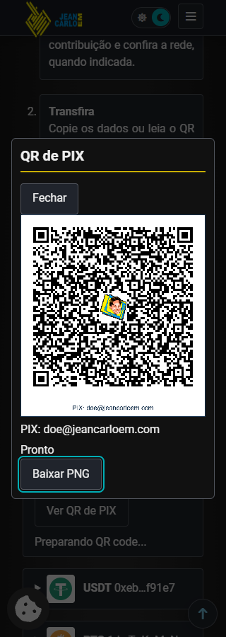

<!-- AI-PROCESSED -->
# Doações — dados, QR, assets e ações

Escopo atual: fonte de dados, helpers e páginas públicas `/doe` e `/doe/obrigado`, com cópia integral, QR local, download PNG e fallback sem JavaScript. A FT-108 está tecnicamente concluída; a validação humana permanece externa.

## Fonte única

Dados em `_data/donations.json` com esquema versionado, meios, assets e metadados.

## APIs exportadas

### `assets/jcem/ts/donations-assets.ts`

- `validateDonationAssets(value: unknown): void` — valida catálogo de assets (máx. 64 itens, IDs únicos, paths e hashes válidos).
- `resolveDonationAsset(catalog: unknown, id: string): DonationAsset | null` — resolve asset por ID; retorna `null` se não encontrado.
- `DonationAsset` — interface com `id`, `path`, `source`, `license`, `sha256`.

### `assets/jcem/ts/donations-actions.ts`

- `getDonationCopyValue(method: DonationMethod): string | null` — extrai chave/endereço para cópia; `null` para PayPal.
- `shortenDonationAddress(value: string): string` — encurta até 10 caracteres Unicode; a UI deve disponibilizar separadamente o valor integral às tecnologias assistivas.
- `copyDonationValue(method: DonationMethod, clipboard: Pick<Clipboard, 'writeText'>): Promise<void>` — copia o valor integral pela interface clipboard recebida; rejeita se indisponível e propaga falhas de writeText.
- `getDonationQrBlob(canvas: HTMLCanvasElement): Promise<Blob>` — exporta PNG do canvas; rejeita se `toBlob` não disponível ou tipo inválido.

<!-- donations-qr-spec:begin -->
### `assets/jcem/ts/donations-qr.ts` — especificação do QR

Fonte: [módulo TypeScript](../assets/jcem/ts/donations-qr.ts).

- `DonationQrSpec`: objeto com `payload: string` e `caption: string` somente leitura.
- `getDonationQrSpec(method: DonationMethod, siteUrl: string): DonationQrSpec | null`
- O método é validado por `validateDonationMethod` antes da seleção do resultado. PayPal retorna `null`, sem criar QR.
- PIX usa o payload informado nos dados e a legenda `PIX: ` seguida da chave; não reconstrói o payload.
- Criptomoeda usa o endereço como payload e a legenda com símbolo em maiúsculas, separador ` | ` e hostname do site sem o prefixo `www.`.
- `siteUrl` é interpretada somente no ramo de criptomoedas: deve ser URL HTTPS com hostname e sem usuário ou senha. Entrada inválida lança erro.
- Esta função retorna dados; não desenha, exporta nem decodifica o QR.

<!-- donations-qr-spec:end -->
<!-- donations-data-contract:begin -->
### Dados de doação (`DonationsData`)

#### Estrutura canônica

O módulo `assets/jcem/ts/donations-data.ts` define tipos e validações estruturais para o JSON canônico de meios de doação.

##### Tipos principais

- `DonationMethodType`: `'pix' | 'crypto' | 'paypal'`
- `DonationMethod`: união discriminada por `type` com campos obrigatórios e opcionais
- `DonationsData`: objeto com `schemaVersion: 1`, `methods: readonly DonationMethod[]` e `assets?: readonly DonationAsset[]` e `thankYou?: DonationThankYou`

##### Validação de método (`validateDonationMethod`)

| Campo | Obrigatório | Validação | Limite/Formato |
|---|---|---|---|
| `id` | Sim | Slug minúsculo seguro (`/^[a-z0-9-]+$/`) | ≤4096 caracteres |
| `type` | Sim | `'pix'`, `'crypto'` ou `'paypal'` | — |
| `label` | Sim | String não vazia | ≤4096 caracteres |
| `iconAssetId` | Opcional | Slug seguro; resolução no validador de coleção | — |
| `networkAssetId` | Opcional | Slug seguro; **só para `crypto`**; resolução no validador de coleção | — |
| `key` | Sim (`pix`) | String não vazia | — |
| `payload` | Sim (`pix`) | String não vazia | — |
| `address` | Sim (`crypto`) | String não vazia | — |
| `symbol`, `name`, `network` | Sim (`crypto`) | Strings não vazias | — |
| `minimumAmount` | Sim (`paypal`) | Número finito ≥0 | — |
| `currency` | Sim (`paypal`) | Sigla maiúscula de 3 letras (`/^[A-Z]{3}$/`) | — |
| `amountMode` | Sim (`paypal`) | `'free'` | — |
| `url` | Sim (`paypal`) | HTTPS, host `www.paypal.com`, path `/donate/`, sem portas não padrão ou credenciais | — |

##### Validação de coleção (`validateDonationsData`)

- `methods`: array denso (sem `undefined`), tamanho entre 1 e 64, IDs únicos
- `assets`: quando presente, é validado por `validateDonationAssets`. Toda referência em `iconAssetId`/`networkAssetId` deve resolver no catálogo; uma referência com catálogo ausente também é rejeitada.
- `schemaVersion`: valor exato `1`
- `thankYou`: opcional para compatibilidade; quando presente, validado por `validateDonationThankYou`.

#### Extensão por dados

- Novas entradas dos tipos já suportados (`pix`, `crypto`, `paypal`) podem ser configuradas no JSON canônico com seus assets e campos obrigatórios. Um novo valor de `type` exige alteração do contrato e do código.
- Validações rejeitam valores fora dos formatos previstos (ex: porta não padrão em URL do PayPal, sigla de moeda inválida, array com buracos).

> Fonte: [`../assets/jcem/ts/donations-data.ts`](../assets/jcem/ts/donations-data.ts)

- Os validadores `validateNonEmptyString` e `validateSlug` limitam as strings a 4096 caracteres e rejeitam conteúdo vazio após `trim`; as restrições adicionais da tabela continuam aplicáveis.
- `validateDonationMethod(value: unknown, index: number = 0): asserts value is DonationMethod` valida um método sem consultar o catálogo.
- `validateDonationsData(value: unknown): asserts value is DonationsData` valida o objeto completo, incluindo unicidade dos IDs e referências. Os validadores lançam erro diante de entrada inválida, sem modificar o valor; validação estrutural não autentica o destinatário financeiro.

<!-- donations-data-contract:end -->

### Metadados do agradecimento

O campo opcional `thankYou` pertence ao mesmo JSON canônico. O validador geral delega sua validação ao [módulo de agradecimento](../assets/jcem/ts/donations-thank-you.ts), que exporta `DonationThankYou` e `validateDonationThankYou(value: unknown): asserts value is DonationThankYou`.

Exemplo atual, derivado de `_data/donations.json` (bloco `thankYou`):

```json
{
  "title": "Obrigado",
  "message": "Seu apoio ajuda a manter este projeto. Muito obrigado por fazer parte dele!",
  "image": {
    "src": "/assets/images/doacoes/agradecimento-cover.webp",
    "alt": "Mãos acolhendo um coração vermelho, em gesto de gratidão."
  },
  "cover": {
    "mode": "wide",
    "composition": "triptych",
    "patterns": {
      "left": "/assets/images/doacoes/agradecimento-left.webp",
      "right": "/assets/images/doacoes/agradecimento-right.webp"
    }
  }
}
```

Título, mensagem e texto alternativo exigem strings não vazias após `trim`, com comprimento original máximo de 4096 caracteres. Os quatro níveis de objeto rejeitam arrays. A composição aceita somente `wide`/`triptych`.

As três imagens exigem paths locais sob `/assets/`, com segmentos não vazios de letras ASCII, dígitos, `_` ou `-` e extensão minúscula `png`, `webp`, `jpg`, `jpeg` ou `svg`. Protocolos, hosts, escapes percentuais, controles, barras invertidas, segmentos `.`/`..`, query e fragmento são rejeitados. A validação não normaliza nem altera os dados.

Ausência de `thankYou` continua válida. O [teste permanente](../scripts/test_donations_thank_you.ts) cobre contrato integrado, compatibilidade, imutabilidade e entradas inválidas; a imagem é vinculada por hash à proveniência. O [original](../assets/images/doacoes/agradecimento-original.png) foi preservado.

#### Retorno `/doe/obrigado/`

A página `/doe/obrigado/` é gerada por uma Page virtual derivada continuamente da home, mantendo o mesmo layout, posts e Pager, substituindo apenas o destaque pelo partial `COVER` oficial. A ordem da imagem, o H1 normal "Obrigado" e a mensagem escapada são preservados.

A fonte de metadados é `_data/donations.json.thankYou`.

Implementação e testes: [`_plugins/jcem_donation_return_page.rb`](../_plugins/jcem_donation_return_page.rb), [`_plugins/jcem_donation_return_rendered_cover.rb`](../_plugins/jcem_donation_return_rendered_cover.rb), [`scripts/test_donation_return_generator.rb`](../scripts/test_donation_return_generator.rb), [`scripts/test_donation_return_rendered_cover.rb`](../scripts/test_donation_return_rendered_cover.rb).

Ilustração versionada: [`assets/images/doacoes/agradecimento-cover.webp`](../assets/images/doacoes/agradecimento-cover.webp) — mãos acolhendo coração vermelho sem texto. Crédito JeanCarloEM, CC-BY-NC-SA4.0.

O pipeline social está registrado em `config/social-images.json` e `_data/jcem_social_images.json`. Não constitui aprovação humana da imagem.

A validação técnica incluiu build Jekyll isolado em produção, 320 e 1366 px nos temas claro e escuro, ausência de overflow e navegação por teclado. Logo e fontes externos foram bloqueados no teste isolado e não foram validados.

Sem JavaScript, `/doe/obrigado` preserva aviso genérico de consentimento do site e não exibe agradecimento. `/doe` mantém fallback próprio. A mensagem agradece apoio, não confirma pagamento; código não altera configuração remota PayPal já informada pelo responsável.

Aceite humano externo permanece pendente. O workflow da FT-110 e a pré-chain global da FT-111 permanecem pendentes. Não houve publicação ou push.


<!-- donations-matrix-canvas:begin -->
### APIs de geração e renderização de QR Codes

Fontes: [matriz e fábrica](../assets/jcem/ts/donations-qr.ts) e [renderização em canvas](../assets/jcem/ts/donations-qr-canvas.ts).

#### `createDonationQrMatrix(payload: string, factory: QrFactory): boolean[][]`

Gera a matriz binária a partir do payload e da fábrica injetada: chama `factory(0, 'H')` e adiciona o payload no modo `Byte`.

- **Entradas**:
  - `payload`: string não vazia, ≤ 4096 caracteres.
  - `factory`: função `(version: 0, correction: 'H') => QrEncoder` que implementa `addData`, `make`, `getModuleCount`, `isDark`.
- **Retorno**: matriz `boolean[][]` quadrada, dimensão `n = 21 + 4k`, entre 21 e 177.
- **Erros**: `Error` para payload/factory inválidos, dimensão inválida ou módulos retornados sem tipo booleano; erros do codificador injetado propagam-se.
- **Dependência browser**: nenhuma (executa em Node.js ou navegador).

#### `renderDonationQrBase(canvas: HTMLCanvasElement, matrix: readonly (readonly boolean[])[], caption: string): void`

Renderiza o QR Code em um `<canvas>` com moldura, módulos pretos e legenda azul.

- **Entradas**:
  - `canvas`: objeto com `getContext('2d')` disponível; requer as APIs de canvas do ambiente.
  - `matrix`: matriz válida conforme `createDonationQrMatrix`.
  - `caption`: string não vazia, ≤ 4096 caracteres.
- **Dimensões**: largura `(n + 8) * 8 + 32` px e altura igual à largura mais 64 px; módulo de 8 px e margem branca de quatro módulos, além da margem externa de 16 px.
- **Estilo**: fundo branco, módulos pretos, borda azul `#17324d`, legenda centralizada em 24 px.
- **Erros**: `Error` para canvas indisponível ou matriz inválida.

#### `renderDonationQrWithSymbol(canvas: HTMLCanvasElement, matrix: readonly (readonly boolean[])[], caption: string, symbol: ImageBitmap, area: {x: number; y: number; size: number}): void`

Sobrescreve a área central com um recorte do bitmap fornecido; as dimensões não autenticam sua identidade.

- **Entradas**:
  - `symbol`: `ImageBitmap` de 372×192 px.
  - `area`: coordenadas e tamanho do quadrado central, conforme `getCenteredQrSymbolArea`.
- **Comportamento**: limpa a área central e usa o recorte `(0, 0, 190, 192)` do bitmap de 372×192 px; ajusta-o proporcionalmente ao quadrado, com altura de `area.size * 8 - 4` px.
- **Erros**: `Error` para símbolo ou área inválidos.

**Notas**:

- As verificações descritas cobrem payload, geometria, legenda, módulos e dimensões do bitmap; não constituem autenticação do destinatário ou do símbolo.
- O desenho usa cores e geometria explícitas, sem consultar o tema. A rasterização depende do canvas e das fontes do ambiente.
- A decodificação automática deve ser feita separadamente, comparando byte a byte ao payload original.
<!-- donations-matrix-canvas:end -->

### Conector DOM de cópia

O módulo [donations-ui.ts](../assets/jcem/ts/donations-ui.ts) exporta `enhanceDonationCopy`, recebendo o elemento raiz, os dados ainda sujeitos à validação e uma interface de clipboard com `writeText`.

- A raiz contém os métodos identificados por `data-donation-id`, conforme a [partial canônica](../_includes/jcem/donations-content.html). O conector valida os dados antes de alterar o DOM e aprimora cada método uma única vez.
- PIX e criptomoedas recebem cópia integral, resumo visual de até dez caracteres e valor integral para tecnologias assistivas. PayPal conserva seu link e não recebe botão de cópia.
- O botão mantém seu nome e sua função nativa; o resultado aparece em uma região de status separada. Falha de clipboard orienta a cópia manual e preserva os campos existentes.
- O módulo não busca dados nem se inicializa automaticamente. A montagem usa o [bootstrap do componente](../assets/jcem/ts/donations-bootstrap.ts), carregado somente pela partial de doações.

### Montagem progressiva

- A partial emite um snapshot JSON inerte da mesma fonte que gera os campos. O escape de `<` mantém a validade do JSON e impede fechamento antecipado do elemento de dados.
- O bootstrap agenda a montagem após `DOMContentLoaded` e duas oportunidades de frame, e só então importa o conector. Não há requisição separada de dados nem inclusão global no tema.
- `mountDonationCopy` evita montagem simultânea ou repetida. JSON inválido ou falha de inicialização preserva os campos e informa a alternativa de cópia manual em uma região de status.
- A montagem também liga os controles QR. O host é importado ao ativar um botão; biblioteca, logo e preparação são carregados pelo produtor cancelável após a abertura do diálogo. A URL canônica e o caminho local do logo vêm de atributos escapados da partial.
- O componente possui CSS e fallback estático. Seu conteúdo e comportamento foram conferidos no build integrado, com o tema e o shell reais.

### Ativação de QR por callback

`enhanceDonationQr`, no [mesmo módulo UI](../assets/jcem/ts/donations-ui.ts), recebe raiz, dados e o callback assíncrono `openQr(method, opener)`. O callback deve resolver somente após o fechamento da visualização ou rejeitar em caso de falha.

- O conector cria controles para PIX e criptomoedas uma única vez, preserva PayPal e bloqueia novas ativações do mesmo botão enquanto a abertura estiver pendente.
- Status e botão permanecem separados. Após resolução ou rejeição, o estado ocupado é removido e o botão recebe foco; falha orienta a cópia manual.
- Esta API delega composição e diálogo aos módulos próprios. O bootstrap atual liga o callback completo aos cinco meios com QR; PayPal conserva sua ação nativa.

### Canvas QR cancelável

`prepareDonationQr`, em [donations-qr-resource.ts](../assets/jcem/ts/donations-qr-resource.ts), recebe documento, método, URL canônica do site, URL local do logo e `AbortSignal`. Retorna um canvas acessível; o consumidor controla sua apresentação.

- Reutiliza os helpers de payload, geometria e composição, com a biblioteca QR local carregada sob demanda.
- O logo deve usar HTTP(S), sem credenciais, na origem do documento e sem redirecionamento. O bitmap permanece disponível durante o desenho e é liberado em `finally`.
- Cancelamento é conferido nas fronteiras assíncronas. Falhas propagam ao consumidor e preservam os dados originais.
- O canvas expõe a legenda canônica em `data-donation-qr-caption`. O diálogo a mostra também como texto legível; produtores anteriores podem fornecer apenas `aria-label` ou usar o título como alternativa.
- O bootstrap fornece este canvas ao diálogo, que exibe e exporta a mesma composição. Os cinco PNGs baixados pela interface foram decodificados contra os valores do JSON canônico.

### Diálogo e download

`showDonationQr`, em [donations-qr-dialog.ts](../assets/jcem/ts/donations-qr-dialog.ts), recebe raiz, título, nome do PNG e um produtor assíncrono de canvas com `AbortSignal`.

- Abre o diálogo e foca Fechar antes de preparar o QR. A promessa permanece pendente enquanto a visualização estiver aberta; o conector restaura o foco ao botão de origem após o fechamento.
- Fechar ou Escape cancela a preparação. Fechamento durante a exportação não cria URL tardia; canvas e URL temporária são liberados.
- O link nativo Baixar PNG aparece quando a exportação termina. O download usa o mesmo canvas exibido, sem exigir uma nova preparação no clique.
- Navegadores sem `showModal` recebem uma visualização com fechamento explícito e sem declarar modalidade. O bootstrap já integra o diálogo; a validação visual completa ainda está pendente.

### Aparência do componente

A partial carrega [donations.css](../assets/jcem/css/donations.css) somente onde a interface é composta. O CSS usa os tokens de cor do tema para cartões, campos, controles e diálogo, preserva os marcadores nativos e mantém foco visível e campos para cópia manual.

- O resumo visual contém até dez caracteres; o texto integral do resumo usa uma regra acessível restrita à doação. Os campos nativos continuam disponíveis.
- O canvas mantém proporção e quiet zone. Vinte capturas dos QRs exibidos em dois temas e duas larguras foram decodificadas contra o JSON, com verificações de foco, contraste, alvos e overflow.
- A validação inicial usou a partial real e tokens extraídos da fonte. Depois, a matriz do build integrado confirmou a composição nos dois temas e em mobile/desktop.
- O diálogo mostra a legenda também em texto complementar legível no mobile. A correção passou em dois temas, dez capturas de QR decodificadas e revisão das duas imagens da interface; o PNG e o payload permanecem preservados.

### Ícones e orientação

O [include de assets](../_includes/jcem/donation-asset.html) resolve `iconAssetId` e `networkAssetId` pelo catálogo canônico. A moeda, a rede e o provedor usam a mesma composição; nenhum endereço de imagem é recadastrado no HTML.

- Ícones locais são decorativos, têm espaço reservado e conservam o rótulo textual. Um ID sem correspondência omite o ícone e preserva os dados e o texto.
- O guia em três passos orienta escolher, transferir e conferir os dados. O link de créditos usa a página compartilhada de atribuições, cujos registros e licenças já existem.
- A verificação cobriu os oito arquivos e seus hashes, dez imagens exibidas, extensão por dados, fallback, escape e quatro combinações de tema/largura. As capturas foram revistas; a integração ao shell completo também foi validada posteriormente.

### Conteúdo sem JavaScript

A fonte compartilhada de `noscript` compõe a mesma partial em `/doe/`. `static_fragment=true` omite dados de hidratação e scripts; `id_prefix='noscript-'` mantém IDs e referências ARIA distintos da cópia normal oculta.

- Os detalhes nativos abrem por teclado. Campos readonly permitem seleção manual; o link PayPal conserva endereço, alvo e proteção de origem.
- O guia estático orienta copiar manualmente, sem sugerir um QR indisponível. As demais páginas conservam o painel genérico existente.
- A validação em navegador com JavaScript desativado cobriu duas larguras, dados exatos, seleção, PayPal, IDs, ausência de pedidos de scripts e overflow. O modo normal também foi conferido.
- A fixture inicial isolou três includes de shell. O gate oficial posterior conferiu o shell real sem JavaScript em mobile e desktop.

## Validação integrada

O build Jekyll de produção foi concluído em destino isolado. O gate visual oficial passou em 320 px, nos temas claro e escuro, incluindo o shell NoScript real. O validador passou a conferir a variante de doações contra o JSON canônico; um PIX estático adulterado foi rejeitado e o ramo genérico de outra página permaneceu válido. A fonte TypeScript em `scripts/visual/noscript.ts` possui JavaScript gerado pareado e verificação de tipos em `check:ts`.

A matriz integrada cobriu 320 e 1366 px, nos dois temas, com 20 cópias por teclado, 20 downloads PNG e 20 rasters exibidos decodificados contra o JSON canônico, além de foco, modal, PayPal e overflow. O clipboard foi um gravador injetado no navegador; não há alegação sobre a área de transferência do SO. Desktop strict e as verificações TypeScript passaram. Isso não comprova a matriz integral de publicação nem a cadeia completa de `build:prod`, reservadas à FT-111.



Captura do artefato real, com consentimento de teste já registrado, sem transação financeira. Para usar a página, abra o meio, escolha Copiar ou Ver QR e, no diálogo, Baixar PNG; Escape fecha o diálogo e devolve o foco. Sem JavaScript, selecione manualmente o campo integral.

## Fontes

- [../RCFs/doacoes.md](../RCFs/doacoes.md)
- [../assets/jcem/ts/donations-assets.ts](../assets/jcem/ts/donations-assets.ts)
- [../assets/jcem/ts/donations-actions.ts](../assets/jcem/ts/donations-actions.ts)

## Restrições reais

- Hash é validação estrutural (integridade física cabe verificador).
- Encurtador usa 4+1+5 caracteres Unicode; não preserva acessibilidade por si.
- Cópia usa valor integral e clipboard injetado; o acesso ao sistema depende da implementação fornecida. O exemplo usa somente memória.
- `getDonationQrBlob` não baixa nem decodifica; depende de canvas renderizado.

O exemplo abaixo roda como módulo Node.js a partir da raiz do repositório (node --input-type=module, recebendo o bloco pela entrada padrão). Usa dados reais e clipboard em memória; não demonstra controles de UI.

<!-- donations-example:begin -->
```javascript
import assert from 'node:assert/strict';
import { readFileSync } from 'node:fs';
import { validateDonationAssets, resolveDonationAsset } from './assets/jcem/js/donations-assets.js';
import { getDonationCopyValue, shortenDonationAddress, copyDonationValue } from './assets/jcem/js/donations-actions.js';

const data = JSON.parse(readFileSync('_data/donations.json', 'utf8'));
validateDonationAssets(data.assets);
const method = data.methods.find(item => item.iconAssetId && getDonationCopyValue(item) !== null);
assert.ok(method);
const asset = resolveDonationAsset(data.assets, method.iconAssetId);
assert.ok(asset);
const value = getDonationCopyValue(method);
assert.equal(typeof value, 'string');
let copied;
await copyDonationValue(method, { writeText: async text => { copied = text; } });
assert.equal(copied, value);
assert.ok(Array.from(shortenDonationAddress(value)).length <= 10);
console.log('DONATIONS_DOCUMENTED_APIS_EXAMPLE_OK');
```
<!-- donations-example:end -->

## Dependências de interface

- FT-108: página `/doe` implementada e tecnicamente validada; aceite humano pendente.
- FT-110: workflow mensal de verificação de assets.
